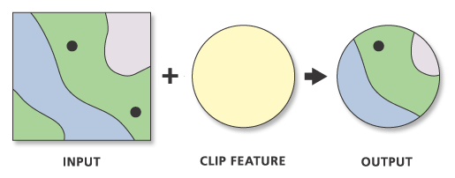

Definitions
================

There are several key terms to cover before we begin working with
spatial data.

## GIS

A geographic information system (GIS) is a computer-based
tool/technology that is used to manage, create, combine, analyze, and
visualize spatial data. For example, many GIS professionals use the
proprietary tool [ArcGIS
Pro](https://www.esri.com/en-us/arcgis/products/arcgis-pro/overview) for
mapping and analysis tasks. The free and open source
[QGIS](https://qgis.org/) is a great alternative. Esri, the company that
owns ArcGIS Pro, defines GIS as follows:

> GIS connects data to a map, integrating location data (where things
> are) with all types of descriptive information (what things are like
> there). This provides a foundation for mapping and analysis that is
> used in science and almost every industry. GIS helps users understand
> patterns, relationships, and geographic context. The benefits include
> improved communication, efficiency, management, and decision-making.
> [(Link)](https://www.esri.com/en-us/what-is-gis/overview)

As we will demonstrate in this workshop, programming languages like R,
which is not specifically a GIS, can also be used to manipulate and
visualize spatial data.

## Spatial Data

Spatial data is what the Esri definition above refers to as “location
data (where things are).” Spatial datasets, or features, contain
*geometry* that tells the GIS or other tool where and how to draw the
features on a map. There are many file types for spatial data; some of
the more common ones include shapefiles, GeoJSON, and KML files.

Depending on what is being mapped, the geometry might be **points**,
**lines**, or **polygons**:

| Feature | Definition | Example |
|:---|:---|:---|
| Points | Single-point locations | locations of schools |
| Lines | Geographic objects too narrow to depict as areas, or features that have length but no area | public transportation routes, contour lines |
| Polygons | Many-sided area features representing the shape and location of homogenous feature types | counties, land-use zones |

## Attribute Data

Returning to Esri’s definition, attribute data is the “descriptive
information (what things are like there),” where *there* refers to the
locations specified by the spatial data. Attribute data looks more like
what we might imagine when we think of data: spreadsheets with columns,
or variables, and rows with cells, or values. These are the attributes
of, or information about, the spatial features: the population density
of the county, the color of the train line, the average standardized
test score of the school.

Taken together, spatial and attribute data can form a map, where the
spatial data features designate what kinds of features go *where*, and
the attribute datasets specify *how* the features appear.

## Coordinate Reference System (CRS)

The simplest definition of a CRS is the designation of how features on a
two-dimensional map are related to real locations on Earth (accomplished
through coordinates).

> IMPORTANT: When combining more than one spatial data layer, it’s
> crucial that all layers are in the same CRS, so that the geographic
> features are accurately positioned relative to each other.

If you care for more details, it’s useful to zoom out and remember that
we create a map, our task is to visualize a three-dimensional object
(the surface of the earth) onto a two-dimensional plane (a computer
screen or piece of paper). Therefore, geographic features are shown in
**map projections**, techniques developed by cartographers to as
accurately as possible represent the globe in 2D space. Every projection
distorts the world in one or more of the characteristics of **angular
conformity**, **distance**, and **area**. The right map projection for a
given GIS project depends on the *scale* of that project (for example,
are we mapping the whole world, or Notre Dame’s campus?) and the goals
of the project (for example, if you intend to analyze distances, a map
projection with less distance distortion is preferable).

Once the map projection is chosen, the CRS defines how a given feature
is located on the projection according to three coordinates (x, y, and
*z*, the vertical axis). [This
article](https://earthdatascience.org/courses/earth-analytics/spatial-data-r/intro-to-coordinate-reference-systems/)
from Earth Lab and [this
one](https://docs.qgis.org/3.44/en/docs/gentle_gis_introduction/coordinate_reference_systems.html)
from QGIS’s documentation may be helpful if you’d like to read up more.
There may be projects in the future where you will need to decide on a
CRS; for today, we are simply interested in how we find out what CRS a
spatial feature is already in, and how we make sure multiple spatial
features have the same CRS.

## Clipping

Clipping, or a *clip analysis*, involves using the geometry (or
geometries) of one spatial layer to “clip out” the geometries from
another layer(s). Typically this is done to reduce a project to a given
study area (e.g., as we will see in our workshop, reducing a spatial
dataset from the entire state of Indiana to St. Joseph County only). The
best way to picture clipping is to imagine that the clipping feature is
a cookie cutter; this feature should always be a polygon feature, so
that the borders of the polygon(s) are the edges of the cookie cutter
and the areas within the borders are the empty space through which we
will clip the input layer(s).

<figure>

<figcaption aria-hidden="true">Example of clipping from Esri, showing
input layer, clip feature, and output.</figcaption>
</figure>

## Today’s R packages

## sf

The [*sf*](https://r-spatial.github.io/sf/) (“Simple Features for R”)
package stores spatial features as records in a table (an sf object),
with the geometries stored within a column. The *sf* package is used
widely by GIS analysts in R and works well with the *tidyverse*. Note
that sf objects have set CRS, which can be reset or replaced, and which
can be identified using the `sf::st_crs()` function.

## tmap

The [*tmap*](https://r-tmap.github.io/tmap/) (“thematic maps in R”)
package is used for drawing maps (spatial visualizations) in R. The
*tmap* package works well with sf objects, and the syntax for creating
maps follows the layering approach of the **grammar of graphics**, the
way that the *ggplot2* package within the *tidyverse* constructs other,
non-spatial data visualizations in R.

## tigris

The
[*tigris*](https://www.rdocumentation.org/packages/tigris/versions/2.2.1)
package can be used to load in the [TIGER/Line
shapefiles](https://www.census.gov/geographies/mapping-files/time-series/geo/tiger-line-file.html)
from the U.S. Census Bureau. There are many other ways to get access to
these features, including downloading them directly from the Census
website, but the *tigris* package simplifies the process and is a great
option when you know that you will be using the features in R.

------------------------------------------------------------------------

We are now ready to jump into R. Download the
[**mapping.R**](../materials/mapping.R) file and open it in RStudio.

### Data

We will be working with spatial and attribute data from the U.S. Census
Bureau, including Indiana census block group data from the 2020
Demographic and Housing Characteristics (DHC), which can be accessed at
[data.census.gov](https://data.census.gov/table/DECENNIALDHC2020.P2?q=urban+rural&g=040XX00US18$1500000&d=DEC+Demographic+and+Housing+Characteristics).
Additionally, using the *tigris* package (see above), we will load in
Indiana census block polygons in R. Finally, when we practice clipping,
we will use the [County Commissioner
Boundaries](https://sjcgis-stjocogis.hub.arcgis.com/datasets/be71408db2274e8b8138fa2ad04c2fa4_0/explore?location=41.597370%2C-86.293999%2C11)
polygons from the St. Joseph County GIS portal.
